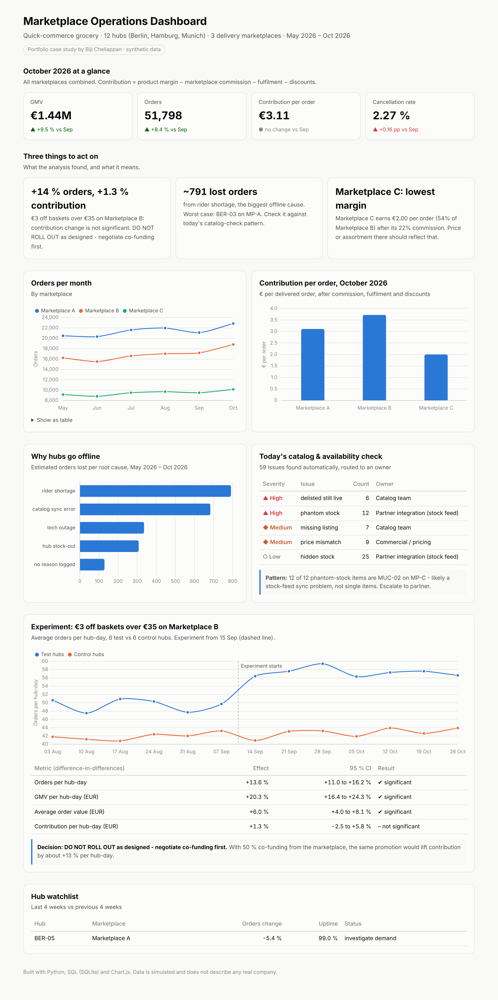

# Marketplace Operations Analytics

**Performance analysis, issue detection, automation and experimentation for a quick-commerce grocery business that sells through external delivery marketplaces.**



> **Data note:** all data in this repository is **synthetic**, generated by `data/generate_data.py` to look like a real operation: 12 dark-store hubs in Berlin, Hamburg and Munich, 3 delivery marketplaces, about 286,000 orders from May to October 2026. It does not describe any real company. The pipeline runs on **any data in the same format**: see [Use your own data](#use-your-own-data).

---

## The problem

A grocery business that sells through delivery marketplaces depends on three things it doesn't fully control:

1. **Performance:** which marketplace, hub and month actually makes money after commission, fulfilment and discounts?
2. **Operational issues:** hubs go offline, catalogs drift, and marketplaces show sold-out items as available. Each issue quietly costs orders, and checking for them by hand every morning is slow and error-prone.
3. **Commercial experiments:** a promotion grows orders, but does it grow **profit**?

This project answers all three with SQL, Python and a dashboard, and automates the daily checks.

## What it does

| Part | File | What it shows |
|---|---|---|
| **Performance analysis** | `sql/01_marketplace_kpis.sql` | Monthly orders, GMV, AOV, cancellations, delivery time and **contribution per order** after commission, fulfilment and discounts |
| **Hub health** | `sql/02_hub_health.sql` | Last 4 weeks vs previous 4 weeks per hub and marketplace; flags low uptime and falling demand |
| **Root-cause analysis** | `sql/03_offline_root_cause.sql` | Why hubs go offline, estimated lost orders per cause, and the worst hub for each cause (uses window functions) |
| **Automated daily check** | `src/catalog_check.py` | 6 checks across catalog, prices, stock and uptime. Every issue gets a severity and an owner, plus a Slack-ready summary that spots patterns |
| **Experiment readout** | `src/experiment_readout.py` | Difference-in-differences with bootstrap confidence intervals, and a clear decision based on contribution |
| **Dashboard** | `dashboard/index.html` | One page with KPIs, three key insights, charts, today's issues and the experiment result |

## Key findings (demo data)

1. **The promotion grew volume, not profit.** "€3 off baskets over €35" on Marketplace B raised orders by **+13.6 %** and average order value by **+6.0 %** (both significant). Contribution moved only **+1.3 %**, which is **not significant** (95 % CI −2.5 % to +5.8 %).
   **Decision: don't roll out as designed. Negotiate co-funding first.** With 50 % co-funding from the marketplace, the same promotion would lift contribution by about **+13 %**.
2. **One integration problem, two symptoms.** All 12 phantom-stock alerts (shown as available, but stock = 0) come from **MUC-02 on Marketplace C**. That's the same hub/marketplace pair that lost the most orders to catalog sync errors over the period. The fix belongs with the partner's stock feed, not with 12 single products.
3. **Not all orders are worth the same.** Marketplace C's 22 % commission leaves **€2.00 contribution per order**, 54 % of Marketplace B's. Volume growth there needs adjusted pricing or a different assortment.

## Automated daily check

```
*Marketplace catalog & availability check*
59 issues found (18 high, 16 medium, 25 low)

- [HIGH] DELISTED_STILL_LIVE: 6 -> Catalog team
- [HIGH] PHANTOM_STOCK: 12 -> Partner integration (stock feed)
- [MEDIUM] MISSING_LISTING: 7 -> Catalog team
- [MEDIUM] PRICE_MISMATCH: 9 -> Commercial / pricing
- [LOW] HIDDEN_STOCK: 25 -> Partner integration (stock feed)

Pattern: 12 of 12 phantom-stock items are MUC-02 on MP-C - likely a stock-feed
sync problem, not single items. Escalate to partner.
```

The full list goes to `reports/issues_latest.csv`. A GitHub Actions workflow (`.github/workflows/daily_check.yml`) shows how to run it every morning.

## How to run

```bash
pip install -r requirements.txt
python run_all.py --demo      # generate the demo data, then run everything
python run_all.py             # run everything on the CSV files in data/csv/
```

Then open `dashboard/index.html` in a browser. The pipeline runs in this order:
`CSV files → SQLite → SQL analyses → catalog check → experiment readout → dashboard`

## Use your own data

Replace the files in `data/csv/` (same file names and columns) and run `python run_all.py`. All names, dates, hubs, marketplaces and texts on the dashboard and in the readout are taken from the data. If a file or column is missing, the run stops with a clear message. Text such as the author name and the data note lives in `config.json`.

### Data dictionary

| File | Required columns | Notes |
|---|---|---|
| `hubs.csv` | `hub_id`, `city` | One row per hub / dark store |
| `marketplaces.csv` | `marketplace_id`, `marketplace_name`, `commission_rate` | Commission as a decimal, e.g. `0.18` |
| `orders.csv` | `order_id`, `order_date`, `hub_id`, `marketplace_id`, `gmv_eur`, `discount_eur`, `delivery_minutes`, `is_cancelled` | One row per order; dates as `YYYY-MM-DD`; `is_cancelled` 0/1 |
| `hub_uptime.csv` | `date`, `hub_id`, `marketplace_id`, `minutes_open`, `minutes_offline`, `offline_reason` | One row per hub, marketplace and day; reason may be empty |
| `catalog_master.csv` | `sku`, `product_name`, `category`, `price_eur`, `is_active` | Your own product master |
| `marketplace_listings.csv` | `marketplace_id`, `sku`, `listed_price_eur`, `is_live` | What each marketplace shows |
| `hub_stock.csv` | `hub_id`, `sku`, `stock_qty` | Current stock |
| `marketplace_hub_availability.csv` | `marketplace_id`, `hub_id`, `sku`, `shown_available` | Availability shown to customers, 0/1 |
| `experiments.csv` | `experiment_id`, `name`, `marketplace_id`, `start_date`, `end_date`, `test_hubs` | `test_hubs` comma-separated; the most recent experiment is analysed |
| `cost_assumptions.csv` | `gross_margin_rate`, `fulfilment_cost_eur` | One row |

## Methods and decisions

- **Contribution, not GMV, is the success metric:** product margin − marketplace commission − fulfilment cost − discounts. A promotion that grows orders without growing contribution isn't a win.
- **Difference-in-differences:** comparing test hubs against control hubs, before and during the experiment, removes trends and seasonality that affect both groups.
- **Cluster bootstrap over hubs:** hubs, not orders, were assigned to test or control, so the confidence interval resamples hubs. Treating 50,000 orders as independent would make the result look far more certain than it is.
- **Lost orders estimate:** offline share of the day × the hub's normal daily orders on that marketplace, using days with less than 30 minutes offline as the baseline.
- **Every issue has an owner:** the automated check routes each issue to a team, so it's actionable rather than just a list.

## What broke and what I learned

- **The first experiment readout was written for a negative result.** When contribution came out flat and not significant, the text no longer fit. The readout now chooses its wording from the actual result: significant gain, significant loss, or no measurable change.
- **The first dashboard had marketplace names, dates and the experiment name typed in by hand,** so it only worked for one dataset. Every label is now read from the data, and the pipeline was tested by changing the data (renamed marketplaces, a removed hub, a new experiment).
- **The root-cause query was first dominated by small, unexplained interruptions.** Short offline periods are now kept separate as "no reason logged". That bucket is a finding in itself: it shows where logging needs to improve.

## What I would build next

- Forecast orders per hub and marketplace for the next 4 weeks and alert when actuals fall below the forecast range.
- Send the daily check summary straight to Slack and auto-create tickets for high-severity issues.
- A pre-experiment power calculation: how many hubs and weeks are needed to detect a given contribution change.
- Use an LLM to draft the weekly performance summary from the SQL outputs, with every number checked against the source tables.

## Project structure

```
├── run_all.py                     # one command: CSV -> reports -> dashboard
├── config.json                    # author, business description, data note
├── data/
│   ├── generate_data.py           # synthetic demo data generator (seeded)
│   └── csv/                       # input data - replace with your own
├── sql/                           # 4 analysis queries (SQLite)
├── src/
│   ├── load_csv.py                # validates CSVs, builds SQLite database
│   ├── run_sql.py                 # runs all SQL, saves results
│   ├── catalog_check.py           # automated daily checks
│   ├── experiment_readout.py      # DiD + bootstrap readout
│   ├── build_dashboard.py         # builds dashboard/index.html
│   └── dashboard_template.html
├── reports/                       # generated outputs (CSV, Markdown, JSON)
├── dashboard/index.html           # generated dashboard
└── .github/workflows/daily_check.yml
```

**Tools:** Python (pandas, NumPy), SQL (SQLite with CTEs and window functions), Chart.js, GitHub Actions.

*Author: Biji Chellappan · [LinkedIn](https://www.linkedin.com/in/biji-chellappan-801b0a24) · [Portfolio](https://biji-sales-coordinator.netlify.app)*
